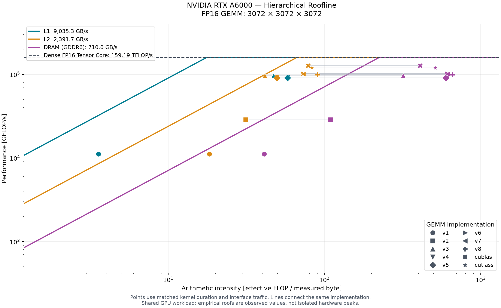

# A6000 分层 Roofline 实测结果

设备：NVIDIA RTX A6000；SM 86；84 个 SM；显存 47.4 GiB；L2 6.0 MiB。
测量时间（UTC）：2026-10-29T07:59:04.071946+00:00。

本次运行时 GPU 上有其他计算负载。以下为共享环境实测最大值，不能作为独占设备的标称峰值。
A6000 的显存是 GDDR6；本文 DRAM 对应任务中所称的 HBM 层。

| 实测指标 | 数值 | 方法 |
|---|---:|---|
| FP32 CUDA core | 25.299 TFLOP/s | 原始 ERT driver1/kernel1 |
| Dense FP16 Tensor Core | 159.192 TFLOP/s | 8 个独立 WMMA 累加器，FP16 累加 |
| L1 | 9035.294 GB/s | 对应接口实测计数器字节数 / kernel 时间 |
| L2 | 2391.744 GB/s | 对应接口实测计数器字节数 / kernel 时间 |
| DRAM | 709.979 GB/s | 对应接口实测计数器字节数 / kernel 时间 |

带宽和 Tensor Core 上限取重复校准的最大值。ERT 标量 FP32 上限仅作参考；FP16 GEMM 图使用单独实测的 FP16 Tensor Core 上限。
ERT 的 read/write logical bandwidth 不能直接当作 L1/L2/DRAM 的物理接口带宽，故另用 `.ca`/`.cg` 加载探针配合计数器校准。
L1 探针使用每 CTA 4 KiB 重复 `.ca` 读取；L2 使用一半 L2 容量的 `.cg` 工作集；DRAM 使用至少 16 倍 L2、且至少 64 MiB 的 `.cg` 工作集。
L1 指标定义为 L1TEX 接口的请求 sector（包含绕过 L1 缓存的访问），不包括 shared-memory 的内部数据流量。

ERT 原生输出：[resluts/A6000/ert/20261029T075835127076Z/Run.001/roofline.json](../resluts/A6000/ert/20261029T075835127076Z/Run.001/roofline.json)。

统一矩阵尺寸 M×N×K = 3072×3072×3072；C=A×B，FP16 输入与输出；执行量按有效算法 FLOP `2*M*N*K` 计算，FMA=2 FLOP。

所有算子在采样的 128 个输出位置上通过 CPU FP64 参考验证；这不等同于全矩阵逐元素验证。
每层 AI = 有效 FLOP / 实测接口字节数。L1/L2 sector 大小均为 32 B。
主图性能与 AI 使用同一次 ncu 样本；取重复样本中 kernel 总时间的中位样本。Event 列来自另一次无 profiler 的 CUDA Event 测量。
NVTX 范围只包围一次预热后的完整 GEMM 调用；包含该调用的所有辅助 kernel，排除初始化、验证和预热。ncu 每次 replay 清缓存，普通计时允许预热缓存，因此两者性能可能不同。

| 算子 | ncu TFLOP/s | Event TFLOP/s | AI L1 (FLOP/B) | AI L2 | AI DRAM | 验证 |
|---|---:|---:|---:|---:|---:|---|
| v1 | 11.178 | 5.965 | 3.570 | 18.304 | 41.167 | PASS |
| v2 | 28.540 | 16.924 | 31.347 | 31.383 | 109.419 | PASS |
| v3 | 96.339 | 93.825 | 47.262 | 41.510 | 318.760 | PASS |
| v4 | 92.206 | 53.429 | 57.962 | 49.540 | 612.846 | PASS |
| v5 | 90.810 | 95.245 | 57.962 | 49.532 | 599.661 | PASS |
| v6 | 101.903 | 87.314 | 73.143 | 73.105 | 610.398 | PASS |
| v7 | 100.630 | 101.041 | 73.143 | 73.089 | 610.470 | PASS |
| v8 | 99.377 | 92.810 | 90.353 | 90.290 | 659.155 | PASS |
| cublas | 126.878 | 61.594 | 78.759 | 78.661 | 409.215 | PASS |
| cutlass | 119.442 | 118.632 | 83.027 | 82.989 | 512.992 | PASS |

在本次统一尺寸与采集条件下，最快的实现为 cublas，ncu 实测 126.878 TFLOP/s，约为 v1 的 11.35 倍。

详细字节数、时间和每次采样见 `operators.csv` / `operators.json`；原始编译和 profiler 日志见 `raw/`。

[SVG 矢量图](A6000/roofline.svg) · [PDF](A6000/roofline.pdf) · [ERT 工作集曲线](A6000/ert_working_set.png)

结果中的上限和算子可能受不同时间的共享负载、时钟及测量重放影响，超出实测屋顶不应解释为超越硬件理论峰值。
